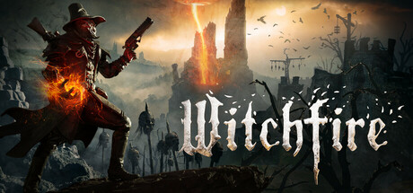

**Witchfire by The Astronauts (Early Access 2023) is a dark fantasy roguelite first-person shooter.**

---

## 📖 About

Witchfire by The Astronauts (Early Access 2023) is a dark fantasy roguelite first-person shooter. You are a preyer hunting supernatural enemies in cursed European settings, acquiring powerful witchfire magic alongside traditional weaponry. Its atmosphere is unmatched but its difficulty is extremely high.

## ⚠️ Problems Without Trainer

| Problem | Status |
|---------|--------|
| Hellfire corruption stacks permanently weakening runs without specific mitigation | ✅ Solved |
| Arcana upgrade costs require multiple successful extractions to progress | ✅ Solved |
| Enemy witch variants absorb projectiles requiring specific magic counter types | ✅ Solved |
| Dying before extraction resets all accumulated witchfire progress per run | ✅ Solved |
| Infernal night encounter density overwhelms without defensive arcana builds | ✅ Solved |

## ✅ Solution

The **Witchfire Trainer** solves all these issues, giving you complete control so you can focus on enjoying the game.

## 🎯 Features

- Unlimited Resources / Currency
- God Mode / Invincibility
- Instant Skill & Ability Cooldown
- One-Hit Kill
- Freeze Timers
- Unlock All Items & Achievements
- Custom Speed Multiplier
- Infinite Stamina / Energy

## 🚀 Quick Start

1. **Disable Windows Defender** temporarily (trainer may trigger false positive)
2. Get the trainer from the button above
3. Launch Witchfire
4. Run the trainer as Administrator
5. Use the hotkeys to activate cheats in-game

## 💎 Free vs Pro

| Feature | Free | Pro |
|---------|------|-----|
| God Mode | ✅ | ✅ |
| Unlimited Resources | ✅ | ✅ |
| Advanced Cheats | ❌ | ✅ |
| Auto-Updates | ❌ | ✅ |
| Priority Support | ❌ | ✅ |

## 💻 Requirements

- Windows 10 / 11 (64-bit)
- Witchfire (any version)
- .NET Framework 4.8+
- DirectX 11+

## 🍎 macOS

## ⚖️ Legal

Educational and single-player use only.

---

